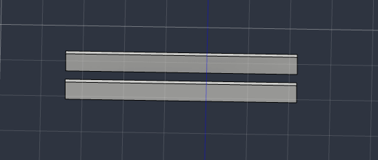
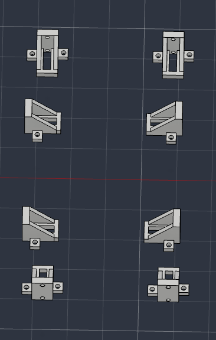
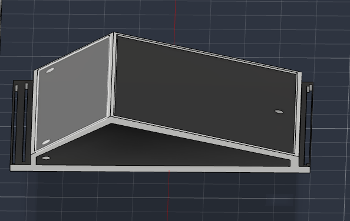
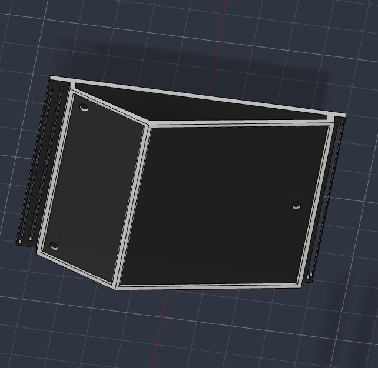
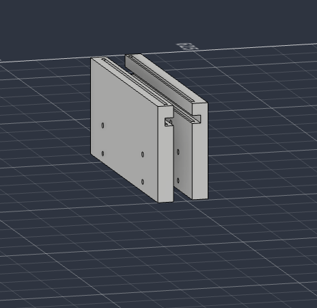
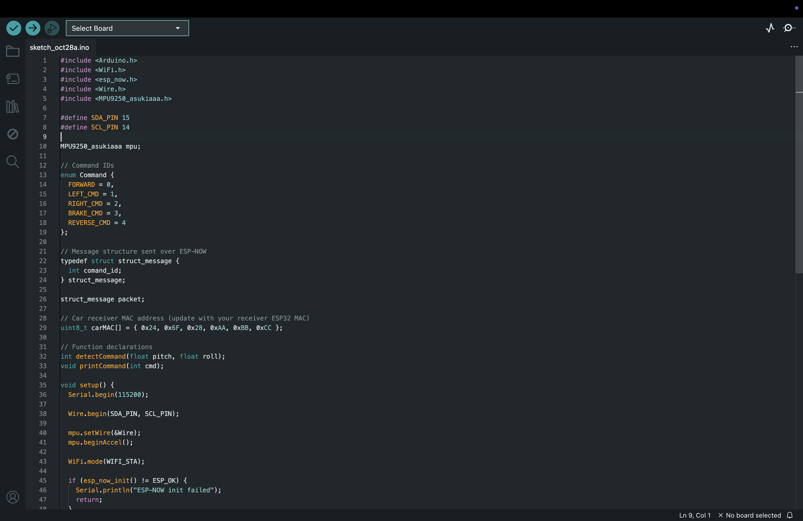
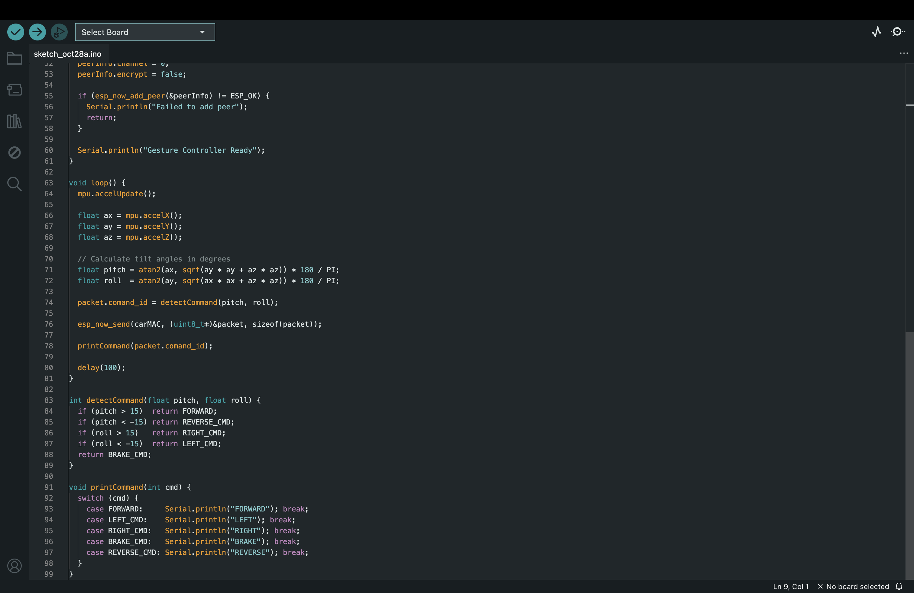

# Ideation and component testing

I decided I was going to build another RC car, and because the joysticks on standard remotes, and buttons on smart phones is so unoriginal and boring, I decided to go with something else. For example, using hand gestures to drive the car would be cool and a whole lot more innovative and exciting than the remote controlled cars we see on the market.

For the brain of the operation, I will be using the ESP32 development board because the ESP-NOW protocol can send small packets of data between devices without needing to connect through a Wi-Fi or Bluetooth gateway in the range of 2-4 milliseconds. The sensor that I decided to use is the MPU-9250 IMU because it provides the data of an accelerometer and gyro combined, which works perfectly for the goal of detecting tilt. The base of the car will be made of 4 BO geared motors and wheels that have rubber on them to make it as rugged as possible, with an L298N double motor controller, and an 18650 Li-ion battery. Also, I decided to use the ultrasonic sensors to stop it from crashing into things on the front bumper.

First I will perform a test breadboard setup and connect everything to the ESP32 boards, just to make sure they all work together the way I intend to.


**Total time spent: 2 hours**

# Circuit diagram and electrical planning

Before committing to any hardware soldering or chassis printing, I sat down in Cirkit Designer to map out the complete wiring diagram. 

For the hand controller, the MPU-9250 communicates with the transmitter ESP32 over I2C using 3.3V, GND, GPIO 15 (SDA), and GPIO 14 (SCL). For the car receiver, I mapped the L298N driver direction pins (LIN1, LIN2, RIN1, RIN2) to GPIOs 26, 25, 17, and 16, and the speed control enable pins (ENA, ENB) to PWM channels on GPIO 32 and 33. 

I also planned the HC-SR04 ultrasonic sensor hookup. The sensor requires 5V supply, but its Echo pin outputs a 5V signal which would burn out the ESP32's 3.3V input pin. So I added a simple resistor voltage divider (1kΩ and 2kΩ) on GPIO 19 to safely step down the echo pulse. Having this schematic ready prevents any wrong pin wiring later.


**Total time spent: 1 hour**

# CAD Part 1 - Main chassis base layout

Started designing the custom car body in Autodesk Fusion 360. Named the project "The Nonchalant". I really wanted to avoid using those flimsy generic acrylic plates from the market that snap easily and leave messy exposed wires everywhere.

Today I began with the main 2D sketch of the lower chassis tub. I laid out the overall footprint and extruded the bottom plate with a 3mm thickness. The main goal here was creating a sunken central battery and motor driver tray so the heavy components sit as low to the ground as possible, keeping the car stable during sharp turns.



**Total time spent: 2 hours**

# CAD Part 2 - Side panels and motor mounting brackets

With the base plate ready, I moved on to designing the side motor mounts. The car uses four BO geared DC motors, so I needed four sturdy mounting brackets directly integrated into the side walls.

I carefully measured the spacing between the mounting holes on the BO motor gearbox with digital calipers. Placed the M3 screw cutouts and modeled slotted vertical tabs on each side so the motors can be bolted firmly with nuts. This ensures the motor output shafts stay parallel and don't wobble or flex under drive torque.



**Total time spent: 2 hours**

# CAD Part 3 - Front bumper and ultrasonic sensor mounts

Today was focused on the front nose section of the chassis. To make the crash prevention look integrated rather than like an afterthought, I designed a dedicated front bumper mount for the HC-SR04 ultrasonic sensor.

I extruded two cylindrical circular cutouts matching the exact outer diameter of the ultrasonic transmitter and receiver cans. Added a small rear retaining lip so the sensor module can push-fit directly from behind without needing extra brackets or ugly zip ties, while aiming straight ahead to detect obstacles.



**Total time spent: 1 hour**

# CAD Part 4 - Full 3D assembly and wheel clearance

Brought all the individual CAD components and bodies together inside Fusion 360 to verify the full assembly. 

The main thing to double-check was wheel clearance. I imported standard 65mm rubber robot wheels and placed them on the motor shafts to make sure there is at least 5mm clearance between the inner tire edge and the chassis walls during fast rotations. Also made sure there was enough interior clearance around the L298N's tall red aluminum heatsink so it doesn't collide with the chassis top.



**Total time spent: 2 hours**

# CAD Part 5 - Structural reinforcement and slicing for print

Final CAD polish day before 3D printing. I added internal structural ribs along the corners and fillets on the motor bracket joints to distribute mechanical stress and avoid layer line fractures.

Exported the complete assembly as a `.step` file and prepared the individual component bodies. Loaded the files into the slicer with 3 perimeters, 20% infill for toughness, and 0.2mm layer height. Hit print and let the 3D printer run overnight to produce the chassis.



**Total time spent: 1 hour**

# Physical chassis assembly and motor mounting

The 3D printed chassis parts came out great! Today was full mechanical assembly day.

I bolted all four BO geared motors into the side brackets using M3 machine screws and lock nuts. Then I press-fitted the receiver ESP32 and the L298N motor driver into the central tray, and slotted the HC-SR04 sensor into the front bumper cutouts. Everything lined up neatly with the screw holes I designed in CAD. 

Tucked the wires along the inner floor of the chassis and checked that the motor shafts rotate freely without any rubbing.


**Total time spent: 2 hours**

# Coding Part 1 - ESP-NOW setup and wireless communication

Today I started writing the transmitter code in the Arduino IDE for the hand controller. 

First I set up all the necessary libraries: `#include <WiFi.h>`, `<esp_now.h>`, `<Wire.h>`, and `<MPU9250_asukiaaa.h>`. Defined the custom I2C pins with `#define SDA_PIN 15` and `#define SCL_PIN 14`. Created an enum for the command IDs (FORWARD, LEFT_CMD, RIGHT_CMD, BRAKE_CMD, REVERSE_CMD) and a lightweight `struct_message` packet containing just the command integer so transmission stays ultra fast.

Inside `setup()`, I initialized the MPU-9250 accelerometer, set `WiFi.mode(WIFI_STA)`, and registered the receiver ESP32's MAC address with `esp_now_add_peer()`. Verified that ESP-NOW initialized successfully and opened the serial monitor to check peer status.



**Total time spent: 1 hour**

# Coding Part 2 - MPU-9250 gesture logic and angle math

For the gestures, I used the MPU-9250. It’s an I2C device that interfaces easily with my transmitter ESP32, as long as you remember to assign I2C to specific pins on your ESP32. GPIO pins 15 and 14 for SDA and SCL respectively are the correct pins. With I2C I was able to begin reading the raw accelerometer data (ax, ay, az).

Now for the next part of my project. It's time for some simple trigonometry. With some simple programming and calculations, I have been able to make an effective angle system, as well as being able to read and distinguish gestures such as forward and backward, and left and right motions of my transmitter ESP32:
```cpp
float pitch = atan2(ax, sqrt(ay * ay + az * az)) * 180 / PI;
float roll  = atan2(ay, sqrt(ax * ax + az * az)) * 180 / PI;
```

Inside `detectCommand(pitch, roll)`, I added a 15-degree threshold filter to eliminate hand tremors: if pitch > 15 it returns FORWARD, if pitch < -15 it returns REVERSE_CMD, and roll tilts return RIGHT_CMD or LEFT_CMD. The packet is dispatched via `esp_now_send()` every 100 ms. Tested tilting my hand and verified clean serial output!



**Total time spent: 2 hours**

# Receiver motor control and floor driving test

Today was the final coding and driving day! 

I wrote the car receiver firmware with an `OnDataRecv` callback to unpack the commands and drive the motors using differential skid steering. Configured ESP32 LEDC hardware PWM on GPIO 32 and 33 running at 1000 Hz with 8-bit resolution. Tuned `motorSpeed` to 180 out of 255 for solid traction without wheel spin on tiles.

Also added the HC-SR04 obstacle avoidance routine: if distance <= 20 cm, the car brakes automatically, waits 200 ms, turns right for 350 ms, and halts safely. Pressed the 65mm rubber wheels onto the motor shafts, powered on the 7.4V battery pack, and placed the car on the floor. Tilting my hand forward drives it ahead, tilting sideways steers it smoothly, and holding my palm flat stops it instantly. Zero lag and super fun to drive!


**Total time spent: 2 hours**
