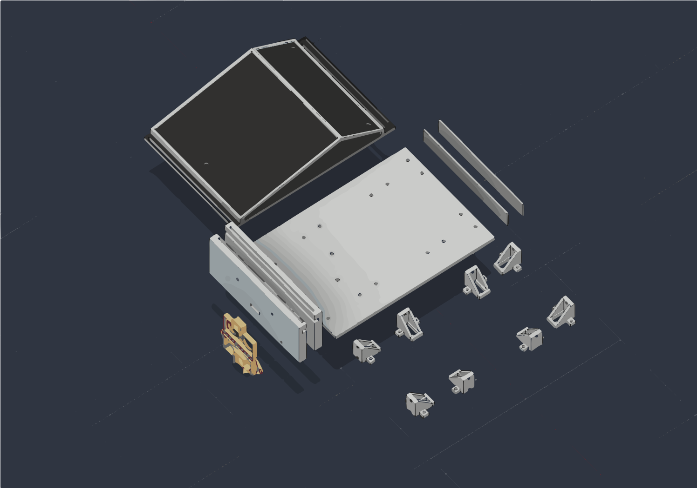

# Ideation and component testing

I decided I was going to build another RC car, and because the joysticks on standard remotes, and buttons on smart phones is so unoriginal and boring, I decided to go with something else. For example, using hand gestures to drive the car would be cool and a whole lot more innovative and exciting than the remote controlled cars we see on the market.

For the brain of the operation, I will be using the ESP32 development board because the ESP-NOW protocol can send small packets of data between devices without needing to connect through a Wi-Fi or Bluetooth gateway in the range of 2-4 milliseconds. The sensor that I decided to use is the MPU-9250 IMU because it provides the data of an accelerometer and gyro combined, which works perfectly for the goal of detecting tilt. The base of the car will be made of 4 BO geared motors and wheels that have rubber on them to make it as rugged as possible, with an L298N double motor controller, and an 18650 Li-ion battery. Also, I decided to use the ultrasonic sensors to stop it from crashing into things on the front bumper.

First I will perform a test breadboard setup and connect everything to the ESP32 boards, just to make sure they all work together the way I intend to.


**Total time spent: 3 hours**

# 3D CAD modeling the chassis in Fusion 360

Before assembling anything physical, I needed a proper custom chassis frame. I really disliked the cheap generic acrylic laser-cut kits from the market bcz they snap easily and all the wires end up hanging out messily.

I hopped into Autodesk Fusion 360 to model a custom tub-style chassis named "The Nonchalant". I designed four side motor mounting bays with screw holes matching the BO geared motor brackets. Inside, I created a deep central compartment to drop the heavy L298N motor driver and 7.4V battery pack so the center of gravity stays low. On the front bumper, I extruded two cylindrical cutouts to hold the transmitter and receiver cans of the HC-SR04 ultrasonic sensor firmly in place.

Spent a lot of time tweaking clearance between the 65mm rubber wheels and the chassis walls so the tires don't rub during skid turns. Exported the full assembly to STEP and STL files for 3D printing.



**Total time spent: 5 hours**

# Mounting motors, wheels and initial workbench assembly

The 3D printed chassis base finished printing, so today was mechanical assembly day before doing any permanent wiring. 

I bolted all 4 BO geared motors onto their side brackets using long M3 machine screws and nuts. Then I pressed the 65mm rubber wheels onto the motor shafts and checked that all four wheels rotate smoothly without binding against the 3D printed plastic walls. 

Next I laid out everything on my floor workbench to plan out the component placement. Placed the L298N driver right in the center, sat the receiver ESP32 next to it, slotted the ultrasonic sensor into the front bumper cutouts, and hooked up the blue 7.4V battery pack. As seen in the photo, there were jumper wires, screwdrivers and electrical tape all over the place, but laying everything out flat made it way easier to verify motor clearances and wire lengths before packaging.


**Total time spent: 4 hours**

# Circuit connections and electronics packaging

Today I moved from the workbench test to packaging the electronics neatly inside the car chassis. 

First I paired the left two motors together in parallel into the L298N OUT1 and OUT2 screw terminals, and the right two motors into OUT3 and OUT4. Then I connected the driver logic pins (IN1, IN2, IN3, IN4, ENA, ENB) to the ESP32 GPIOs (26, 25, 17, 16, 32, 33). 

Here I ran into a really annoying issue: whenever the motors kicked on, the ESP32 immediately brownout reset! I checked with a multimeter and realized that the initial stall current from four DC motors caused a momentary voltage dip and ground noise. To fix this, I tied the battery negative, L298N GND and ESP32 GND into one solid common ground junction, and added a decoupling capacitor across the power rail. Also wired a resistor voltage divider (1kΩ and 2kΩ) on the HC-SR04 Echo pin bcz it outputs 5V while ESP32 pins are strictly 3.3V tolerant.

Once all connections were verified against the schematic, I secured the battery and tucked all the wiring cleanly into the chassis.


**Total time spent: 4 hours**

# Coding: Transmitter, MPU-9250 gesture logic and ESP-NOW

For the gestures, I used the MPU-9250. It’s an I2C device that interfaces easily with my transmitter ESP32, as long as you remember to assign I2C to specific pins on your ESP32. GPIO pins 15 and 14 for SDA and SCL respectively are the correct pins. With I2C I was able to begin reading the raw accelerometer data (ax, ay, az).

Now for the next part of my project. It's time for some simple trigonometry. With some simple programming and calculations, I have been able to make an effective angle system, as well as being able to read and distinguish gestures such as forward and backward, and left and right motions of my transmitter ESP32:
pitch = atan2(ax, sqrt(ay*ay + az*az)) * 180 / 3.14
roll  = atan2(ay, sqrt(ax*ax + az*az)) * 180 / 3.14

A big hurdle was that natural hand tremors were triggering jittery false commands while holding the hand flat. I coded a 15-degree deadzone filter so small tilts don't register. Then I configured ESP-NOW in Wi-Fi station mode, registered the car ESP32's MAC address as an unencrypted peer, and packaged the commands into a small 4-byte struct packet sent every 100 ms. 

Tested holding the transmitter board in my palm and tilting in all four directions. Serial monitor printed FORWARD, REVERSE, LEFT, RIGHT, and BRAKE cleanly with zero lag!


**Total time spent: 5 hours**

# Coding: Receiver firmware, motor PWM and obstacle logic

Today was a heavy coding session dedicated to the receiver ESP32 on the car. 

First I wrote the ESP-NOW receive callback `OnDataRecv` to unpack incoming commands. The car uses differential skid steering, so I had to write individual functions for `Forward()`, `Left()`, `Right()`, `Brake()`, and `Reverse()`. To control the speed smoothly without stalling the motors, I configured ESP32 hardware LEDC PWM on GPIO 32 (PWMA) and GPIO 33 (PWMB) running at 1000 Hz with 8-bit resolution (0-255). 

Next came the obstacle avoidance logic:
```cpp
long duration = pulseIn(ECHO_PIN, HIGH, 30000);
long distance = duration * 0.034 / 2;
```
Inside the main loop, if distance <= 20 cm, the car automatically overrides incoming gesture packets, brakes immediately, waits 200 ms, turns right for 350 ms, and halts safely. 

Debugging took quite some time because `pulseIn()` was blocking for up to 30ms if no echo returned, causing slight packet stutter. I added a timeout condition to keep the loop snappy.


**Total time spent: 6 hours**

# Obstacle detection testing and calibration

With both the transmitter and receiver sketches flashed, today was all about calibrating the HC-SR04 ultrasonic sensor on the car.

I set up test cardboard boxes and walls on the floor and drove the car towards them. Found out that at higher speeds, 15 cm threshold was too close bcz mechanical momentum would carry the car into the obstacle before the motors finished braking. I adjusted `OBSTACLE_DISTANCE` to 20 cm in the code, which gave the car plenty of room to brake, pause, and pivot 90 degrees to the right.

Also added a safety check directly inside `Forward()` so the car refuses to drive forward if an obstacle is already sitting right in front of its nose. Tested waving my hand in front of the sensor while commanding forward, and the car reliably braked every single time.


**Total time spent: 3 hours**

# Floor driving test and speed calibration

Today was the first full ground driving test with the hand controller!

Put the car on the tiled living room floor. At first I had the motor speed set to 220, but the car had way too much wheel spin on the smooth tiles and was sliding around like it was on ice. I dialed down `motorSpeed` to 180 out of 255 in the receiver sketch. At 180, the BO motors had plenty of torque to start rolling instantly from dead stop while maintaining solid tire grip.

Drove straight paths back and forth across the room. Tilting my hand forward drives both sides forward, and flattening my hand stops the car instantly. The responsiveness over ESP-NOW feels incredible with virtually no perceptible latency.


**Total time spent: 4 hours**

# Fine-tuning differential steering, reverse toggle and final demo

Final day of testing and fine-tuning. 

I noticed that turning left was slightly sluggish compared to turning right due to minor motor manufacturing differences. I balanced the PWM duty cycles during turns: when turning left, left wheels stop completely (`ledcWrite(CH_A, 0)`) while right wheels spin at full 180 speed (`ledcWrite(CH_B, motorSpeed)`), allowing the car to pivot sharply in place.

I also tested the reverse toggle feature: tilting my hand backwards flips the `Reversed` boolean flag, reversing motor polarity so tilting forward backs the car out of corners. 

Wrapped up the project by recording the full driving demo video showing hand tilts, sharp skid turns, obstacle avoidance, and reverse driving. Everything works reliably!


**Total time spent: 3 hours**
