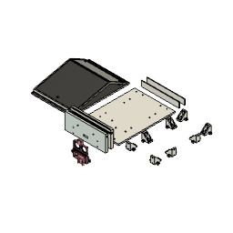

# Ideation and component testing

I decided I was going to build another RC car, and because the joysticks on standard remotes, and buttons on smart phones is so unoriginal and boring, I decided to go with something else. For example, using hand gestures to drive the car would be cool and a whole lot more innovative and exciting than the remote controlled cars we see on the market.

For the brain of the operation, I will be using the ESP32 development board because the ESP-NOW protocol can send small packets of data between devices without needing to connect through a Wi-Fi or Bluetooth gateway in the range of 2-4 milliseconds. The sensor that I decided to use is the MPU-9250 IMU because it provides the data of an accelerometer and gyro combined, which works perfectly for the goal of detecting tilt. The base of the car will be made of 4 BO geared motors and wheels that have rubber on them to make it as rugged as possible, with an L298N double motor controller, and an 18650 Li-ion battery. Also, I decided to use the ultrasonic sensors to stop it from crashing into things on the front bumper.

First I will perform a test breadboard setup and connect everything to the ESP32 boards, just to make sure they all work together the way I intend to.

**Total time spent: 3 hours**

# Circuit diagram and MPU-9250 gesture logic

For the gestures, I used the MPU-9250. It’s an I2C device that interfaces easily with my transmitter ESP32, as long as you remember to assign I2C to specific pins on your ESP32.GPIO pins 15 and 14 for SDA and SCL respectively are the correct pins. With I2C I was able to begin reading the raw accelerometer data (ax, ay, az).

Now for the next part of my project. It's time for some simple trigonometry. With some simple programming and calculations, I have been able to make an effective angle system, as well as being able to read and distinguish gestures such as forward and backward, and left and right motions of my transmitter ESP32. 

This gesture system combined with the code I have already written for the drive system of the ESP32 has now resulted in my being able to drive my robot around as well as execute various driving motions by performing various gestures of my transmitter. I'm very excited about my new invention. 

Stay tuned for more updates as I will add other cool functions and improvements in the near future!

**Total time spent: 4 hours**

# Building the hand-held gesture controller

Today i assembled the transmitter setup so i can actually hold it comfortably in hand while testing. Placed the ESP32 and MPU-9250 together and wired 3V3, GND, SDA and SCL firmly so nothing comes loose when moving my wrist around.

Wrote the ESP-NOW transmitter code. First i extracted the car ESP32's MAC address and registered it as an unencrypted peer on channel 0. Created a simple payload packet with just an integer for the command ID. Set the packet send rate to 100ms. Tested holding the controller in hand and tilting forward, back, left and right. Opened serial monitor on laptop and all commands were printing smoothly as my hand moved.

Carrying the board in palm feels really natural and lightweight.

**Total time spent: 3 hours**

# 3D CAD modeling in Fusion 360

Started designing the custom chassis in Autodesk Fusion 360. Named the model "The Nonchalant". I really disliked the generic transparent acrylic laser cut chassis from market bcz they are fragile and look very messy with wires popping out from all sides.

I wanted a tub-style chassis with clean exterior where all 4 BO motors mount firmly on the side brackets and the heavy components like 7.4v battery and L298N stay secure inside the central tray. The hardest part was getting the motor bracket dimensions and screw hole spacing accurate so the wheels sit aligned and don't rub against the chassis walls. Also designed custom cylindrical front mounts to hold the transmitter and receiver eyes of the HC-SR04 ultrasonic sensor.

Exported the complete assembly as .step file and prepared individual body components for 3D printing. Took nearly 5 hours tweaking fillets and wall thickness.

**Total time spent: 5 hours**

# Mounting motors, wheels and initial workbench wiring

The printed chassis parts were ready so today was full mechanical assembly day. Screwed all 4 BO geared motors onto their brackets and pressed the 65mm rubber wheels onto the motor shafts. 

Laid everything out on the floor workbench to start testing the motor connections with the L298N driver and the receiver ESP32. Connected the ultrasonic sensor temporarily to check wire lengths and hooked up the blue 7.4V battery pack. As you can see in the photo there's a big mess of jumper wires and tools everywhere, but having all parts laid out flat makes it 10x easier to debug connections before stuffing everything into the chassis.

**Total time spent: 4 hours**

# Electronics packaging and driver wiring

Now the real headache started which was packing all this wiring neatly inside the car body. The L298N driver has that tall red aluminum heat sink which takes up crazy amount of vertical height. Placed the driver right in the center and wired left two motors in parallel to OUT1/OUT2 and right motors to OUT3/OUT4.

Here i hit a big issue: whenever motors started spinning, the ESP32 kept brownout resetting! Took me an hour of debugging with multimeter to realize that when DC motors draw initial stall current, battery voltage drops slightly and creates noise on power rail. Also i had not tied all grounds together properly. Connected battery negative, L298N GND and ESP32 GND into a single common ground junction and added a capacitor across the power input. After that the resets completely disappeared.

**Total time spent: 4 hours**

# HC-SR04 ultrasonic sensor and crash testing

Today i mounted the HC-SR04 ultrasonic sensor into the front bumper of the chassis. Fitted the two round sensor cans into the 3D printed cutouts and glued them with a dab of hot glue from behind so vibration won't knock it loose.

Wired Trig to GPIO 18 and Echo to GPIO 19. Important thing here is HC-SR04 runs on 5V and its Echo pin outputs a 5V pulse, but ESP32 GPIO pins are strictly 3.3V tolerant. If you connect it directly you risk damaging the ESP32 input pin. So i built a quick voltage divider using two resistors (1k and 2k) to step down the 5V echo pulse to safe 3.3V level.

Wrote the obstacle avoidance code: if distance <= 20 cm, the car brakes immediately, pauses 200ms, turns right for 350ms, and halts. Tested putting obstacles right in front on the ground to make sure the evasion triggers before hitting.

**Total time spent: 3 hours**

# Indoor driving and speed calibration

Today was first real ground driving day! Put the car on the living room floor and powered both transmitter and receiver.

First problem was speed: at full duty cycle (255) the car was launching forward too aggressively and sliding on the tiles. I configured the ESP32 LEDC hardware PWM on GPIO 32 and GPIO 33 at 1000 Hz with 8-bit resolution, and dialed down the driving speed to 180. That gave the motors enough torque to start rolling without wheel spin.

Drove straight paths and tested forward and braking gestures. The car glides across the floor smoothly whenever i tilt my hand forward, and stops dead in its tracks when i level my palm flat.

**Total time spent: 4 hours**

# Tuning skid steering and final demo

Final day of testing and fine-tuning. Had to calibrate the skid steering bcz turning left was initially pivoting too slowly compared to turning right. Tuned the PWM values for differential drive: left turn stops left wheels while right wheels spin at 180, and right turn stops right wheels while left wheels spin at 180.

Also tested the reverse mode toggle by pitching my hand backward. It flips the direction flag so the next forward tilt drives the car in reverse, which is super handy when you get stuck in a tight corner under a table.

Recorded the final driving demo video showing hand tilting and the car steering responsively across the room. Everything works reliably with zero lag!

**Total time spent: 3 hours**
