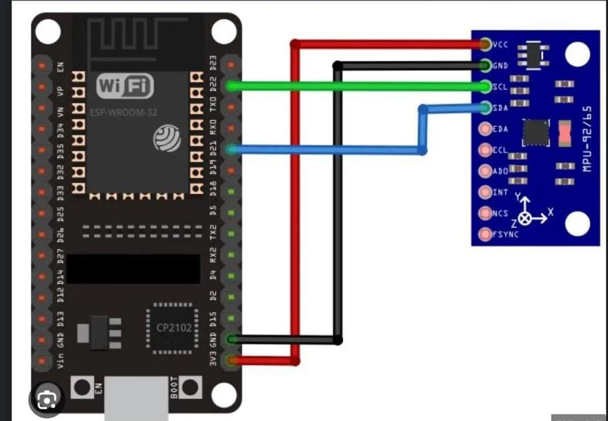
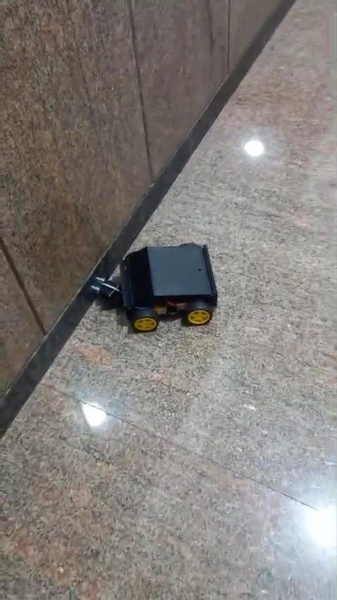
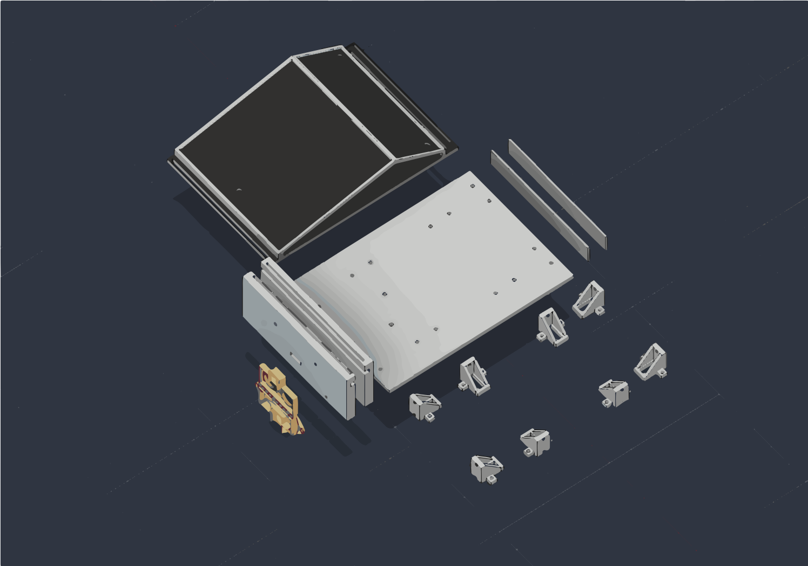
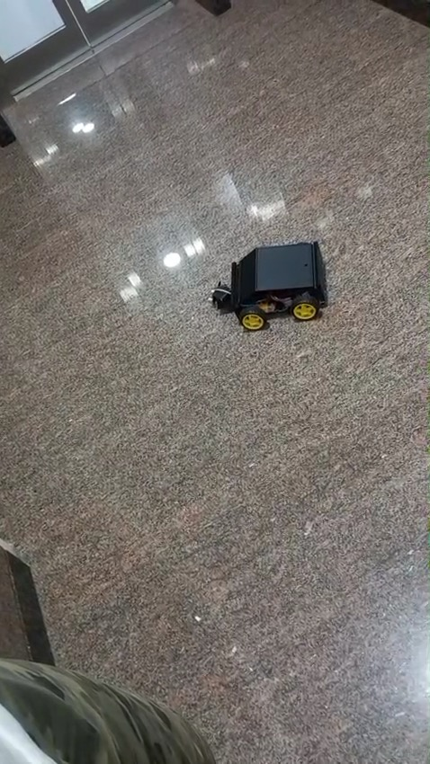
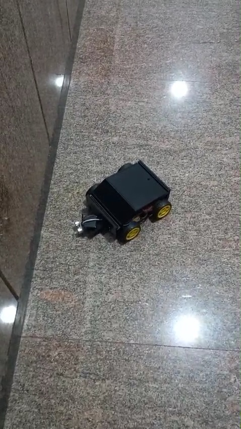
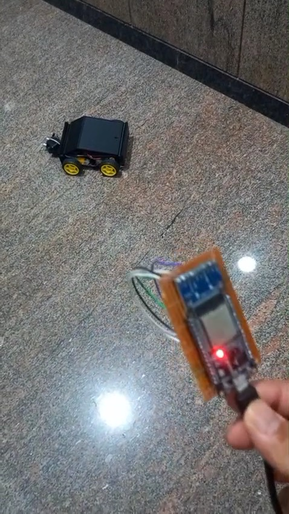

# Ideation and component testing

So currently i was thinking to build another rc vehicle bcz normal remote controllers with joysticks or mobile phone buttons feels too boring and mainstream. I wanted to build something intuitive like just tilting my palm to drive a car around.

For components i decided to use two ESP32 dev boards instead of Arduino or regular RF modules. Reason is ESP32 has ESP-NOW protocol which sends small data packets directly between boards in 2-4 milliseconds without needing any wifi router or bluetooth pairing hassle. For the tilt sensing part i picked MPU-9250 9-axis imu module bcz it has both accelerometer and gyro. For the car base i gathered 4 yellow BO geared motors with rubber wheels, an L298N dual h-bridge motor driver and an 7.4v li-ion battery. Also decided to slap an HC-SR04 ultrasonic sensor on front bumper for crash prevention.

Did a quick breadboard test with jumper wires to see if both ESP32 boards boot up and communicate properly.

**Total time spent: 3 hours**

# Circuit diagram and MPU-9250 gesture logic

Today i sat down to write code for reading hand gestures from the MPU-9250. Wired it up to the transmitter ESP32 using I2C on GPIO 15 (SDA) and GPIO 14 (SCL). At first serial monitor was just throwing zeroes continuously bcz i forgot to pass custom pins inside Wire.begin(15, 14). Once that was fixed the raw accelerometer data (ax, ay, az) started printing cleanly.

Next part was math. Used atan2 formula to calculate pitch and roll angles in degrees:
pitch = atan2(ax, sqrt(ay*ay + az*az)) * 180 / 3.14
roll = atan2(ay, sqrt(ax*ax + az*az)) * 180 / 3.14

Main problem here was my hand was shivering slightly while holding it flat, so it kept sending random commands. To fix this i added a 15-degree deadzone threshold. So now if tilt is between -15 and +15 degrees it considers hand flat and sends BRAKE. If pitched forward > 15 deg it triggers FORWARD, tilted back gives REVERSE toggle, and roll tilts trigger LEFT and RIGHT.

Also drew out the complete circuit schematic in cirkit designer so i don't mess up connections when wiring everything permanently.

**Total time spent: 4 hours**

# Building the hand-held gesture controller

Today i assembled the transmitter setup so i can actually hold it comfortably in hand while testing. Placed the ESP32 and MPU-9250 together and wired 3V3, GND, SDA and SCL firmly so nothing comes loose when moving my wrist around.

Wrote the ESP-NOW transmitter code. First i extracted the car ESP32's MAC address and registered it as an unencrypted peer on channel 0. Created a simple payload packet with just an integer for the command ID. Set the packet send rate to 100ms. Tested holding the controller in hand and tilting forward, back, left and right. Opened serial monitor on laptop and all commands were printing smoothly as my hand moved.

Carrying the board in palm feels really natural and lightweight.

**Total time spent: 3 hours**

# 3D CAD modeling in Fusion 360

Started designing the custom chassis in Autodesk Fusion 360. Named the model "The Nonchalant". I really disliked the generic transparent acrylic laser cut chassis from market bcz they are fragile and look very messy with wires popping out from all sides.

I wanted a tub-style chassis with clean exterior where all 4 BO motors mount firmly on the side brackets and the heavy components like 7.4v battery and L298N stay secure inside the central tray. The hardest part was getting the motor bracket dimensions and screw hole spacing accurate so the wheels sit aligned and don't rub against the chassis walls. Also designed custom cylindrical front mounts to hold the transmitter and receiver eyes of the HC-SR04 ultrasonic sensor.

Exported the complete assembly as .step file and prepared individual body components for 3D printing. Took nearly 5 hours tweaking fillets and wall thickness.

**Total time spent: 5 hours**

# Chassis assembly and L298N motor wiring

The printed chassis parts were ready so today was full mechanical assembly day. Screwed all 4 BO geared motors onto their brackets and pressed the 65mm rubber wheels onto the motor shafts. 

Then came the wiring inside. Paired the two left motors together in parallel into OUT1 and OUT2 screw terminals on L298N, and the two right motors into OUT3 and OUT4. 

Here i hit a big issue: whenever motors started spinning, the ESP32 kept brownout resetting! Took me an hour of debugging with multimeter to realize that when DC motors draw initial stall current, battery voltage drops slightly and creates noise on power rail. Also i had not tied all grounds together properly. Connected battery negative, L298N GND and ESP32 GND into a single common ground junction and added a capacitor across the power input. After that the resets completely disappeared.

**Total time spent: 4 hours**

# HC-SR04 ultrasonic sensor and crash testing

Today i mounted the HC-SR04 ultrasonic sensor into the front bumper of the chassis. Fitted the two round sensor cans into the 3D printed cutouts and glued them with a dab of hot glue from behind so vibration won't knock it loose.

Wired Trig to GPIO 18 and Echo to GPIO 19. Important thing here is HC-SR04 runs on 5V and its Echo pin outputs a 5V pulse, but ESP32 GPIO pins are strictly 3.3V tolerant. If you connect it directly you risk damaging the ESP32 input pin. So i built a quick voltage divider using two resistors (1k and 2k) to step down the 5V echo pulse to safe 3.3V level.

Wrote the obstacle avoidance code: if distance <= 20 cm, the car brakes immediately, pauses 200ms, turns right for 350ms, and halts. Tested putting obstacles right in front on the ground to make sure the evasion triggers before hitting.

**Total time spent: 3 hours**

# Indoor driving and speed calibration

Today was first real ground driving day! Put the car on the living room floor and powered both transmitter and receiver.

First problem was speed: at full duty cycle (255) the car was launching forward too aggressively and sliding on the tiles. I configured the ESP32 LEDC hardware PWM on GPIO 32 and GPIO 33 at 1000 Hz with 8-bit resolution, and dialed down the driving speed to 180. That gave the motors enough torque to start rolling without wheel spin.

Drove straight paths and tested forward and braking gestures. The car glides across the floor smoothly whenever i tilt my hand forward, and stops dead in its tracks when i level my palm flat.

**Total time spent: 4 hours**

# Tuning skid steering and final demo

Final day of testing and fine-tuning. Had to calibrate the skid steering bcz turning left was initially pivoting too slowly compared to turning right. Tuned the PWM values for differential drive: left turn stops left wheels while right wheels spin at 180, and right turn stops right wheels while left wheels spin at 180.

Also tested the reverse mode toggle by pitching my hand backward. It flips the direction flag so the next forward tilt drives the car in reverse, which is super handy when you get stuck in a tight corner under a table.

Recorded the final driving demo video showing hand tilting and the car steering responsively across the room. Everything works reliably with zero lag!

**Total time spent: 3 hours**
