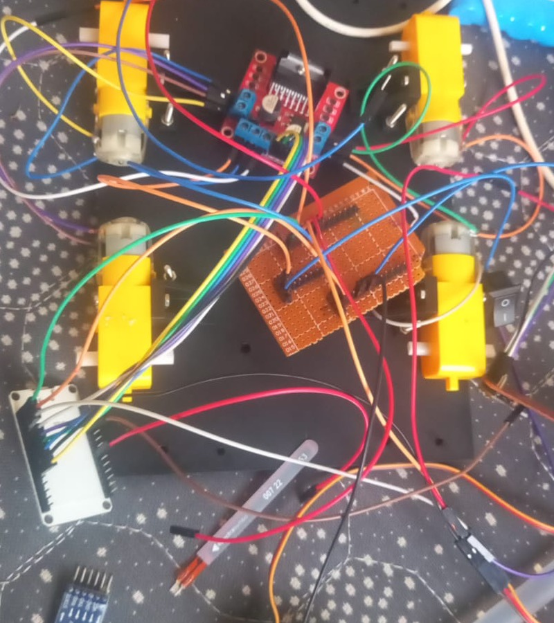
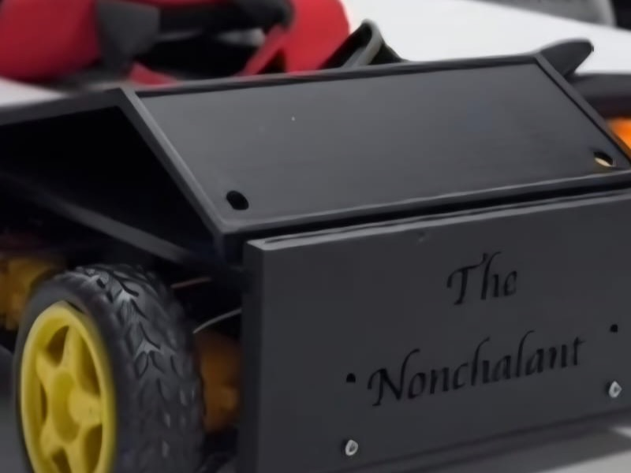

# October 18, 2026: Ideation and component hunting

So currently i was thinking to build another rc vehicle bcz normal remote controllers with joysticks or mobile phone buttons feels too boring and mainstream. I wanted to build something intuitive like just tilting my palm to drive a car around.

For components i decided to use two ESP32 dev boards instead of Arduino or regular RF modules. Reason is ESP32 has ESP-NOW protocol which sends small data packets directly between boards in 2-4 milliseconds without needing any wifi router or bluetooth pairing hassle. For the tilt sensing part i picked MPU-9250 9-axis imu module bcz it has both accelerometer and gyro. For the car base i gathered 4 yellow BO geared motors with rubber wheels, an L298N dual h-bridge motor driver and an 7.4v li-ion battery. Also decided to slap an HC-SR04 ultrasonic sensor on front bumper for crash prevention.

Did a quick breadboard test with jumper wires to see if both ESP32 boards boot up and communicate properly.

**Total time spent: 3 hours**

# October 19, 2026: IMU reading and tilt angle math

Today i sat down to write code for reading hand gestures from the MPU-9250. Wired it up to the transmitter ESP32 using I2C on GPIO 15 (SDA) and GPIO 14 (SCL). At first serial monitor was just throwing zeroes continuously bcz i forgot to pass custom pins inside Wire.begin(15, 14). Once that was fixed the raw accelerometer data (ax, ay, az) started printing cleanly.

Next part was math. Used atan2 formula to calculate pitch and roll angles in degrees:
pitch = atan2(ax, sqrt(ay*ay + az*az)) * 180 / 3.14
roll = atan2(ay, sqrt(ax*ax + az*az)) * 180 / 3.14

Main problem here was my hand was shivering slightly while holding it flat, so it kept sending random commands. To fix this i added a 15-degree deadzone threshold. So now if tilt is between -15 and +15 degrees it considers hand flat and sends BRAKE. If pitched forward > 15 deg it triggers FORWARD, tilted back gives REVERSE toggle, and roll tilts trigger LEFT and RIGHT.

Also drew out the complete circuit schematic in cirkit designer so i don't mess up connections when wiring everything permanently.

**Total time spent: 4 hours**

# October 20, 2026: ESP-NOW wireless communication tests

Today was focused on wireless link between the two ESP32s. I flashed a small MAC address reader sketch on the receiver ESP32 and noted down its address from serial monitor, then put that MAC address into peerInfo in the transmitter sketch.

Created a simple data struct with just one integer for comand_id:
typedef struct struct_message {
  int comand_id;
} struct_message;

Set transmission delay to 100ms. Tested walking into another room with the transmitter board while checking serial monitor on my laptop connected to the receiver board. Packets were arriving super fast with zero dropped packets and almost no noticeable delay. 

Bench tested the L298N driver with the receiver esp32 using jumper wires to make sure logic signals were toggling HIGH and LOW correctly.

**Total time spent: 3 hours**

# October 21, 2026: 3D CAD modeling in Fusion 360

Started designing the custom chassis in Autodesk Fusion 360. Named the model "The Nonchalant". I really disliked the generic transparent acrylic laser cut chassis from market bcz they are fragile and look very messy with wires popping out from all sides.

I wanted a tub-style chassis with clean exterior where all 4 BO motors mount firmly on the side brackets and the heavy components like 7.4v battery and L298N stay secure inside the central tray. The hardest part was getting the motor bracket dimensions and screw hole spacing accurate so the wheels sit aligned and don't rub against the chassis walls. Also designed custom cylindrical front mounts to hold the transmitter and receiver eyes of the HC-SR04 ultrasonic sensor.

Exported the complete assembly as .step file and prepared individual body components for 3D printing. Took nearly 5 hours tweaking fillets and wall thickness.

**Total time spent: 5 hours**

# October 22, 2026: Mounting motors, wheels and driver wiring

The printed chassis parts were ready so today was full mechanical assembly day. Screwed all 4 BO geared motors onto their brackets and pressed the 65mm rubber wheels onto the motor shafts. 

Then came the wiring inside. Paired the two left motors together in parallel into OUT1 and OUT2 screw terminals on L298N, and the two right motors into OUT3 and OUT4. 

Here i hit a big issue: whenever motors started spinning, the ESP32 kept brownout resetting! Took me an hour of debugging with multimeter to realize that when DC motors draw initial stall current, battery voltage drops slightly and creates noise on power rail. Also i had not tied all grounds together properly. Connected battery negative, L298N GND and ESP32 GND into a single common ground junction and added a capacitor across the power input. After that the resets completely disappeared.

**Total time spent: 4 hours**

# October 23, 2026: Front obstacle sensor and bumper integration

Today i mounted the HC-SR04 ultrasonic sensor into the front bumper of the chassis. Fitted the two round sensor cans into the 3D printed cutouts and glued them with a dab of hot glue from behind so vibration won't knock it loose.

Wired Trig to GPIO 18 and Echo to GPIO 19. Important thing here is HC-SR04 runs on 5V and its Echo pin outputs a 5V pulse, but ESP32 GPIO pins are strictly 3.3V tolerant. If you connect it directly you risk damaging the ESP32 input pin. So i built a quick voltage divider using two resistors (1k and 2k) to step down the 5V echo pulse to safe 3.3V level.

Wrote a quick test loop using pulseIn() to measure distance in centimeters. Tested bringing my palm in front of the car and verified that distance readings were accurate within 2 to 3 cm.

**Total time spent: 3 hours**

# October 24, 2026: Full integration, reverse toggle and floor testing

Final assembly and tuning day! Combined all codes together into the final receiver sketch: ESP-NOW callback, PWM speed control on GPIO 32 and 33, and the ultrasonic obstacle loop.

First test run had a funny issue: when i tilted my hand left the car turned right, and when i tilted right it turned left. Realized i had swapped LIN and RIN motor control pins in the sketch. Fixed that in five minutes. Also tuned the motor speed to 180 out of 255 using 1000 Hz 8-bit LEDC PWM so it has plenty of torque to drive on carpet without running too wild.

Tested the obstacle avoidance: when distance drops below 20 cm, the car automatically overrides gesture commands, brakes immediately, waits 200 ms, turns right for 350 ms, and stops. Tested driving directly towards a cardboard box and the car braked and pivoted away on its own.

Put the controller on my hand and drove the car around the living room floor. Tilting hand forward moves it forward, tilting sideways steers it smoothly, and holding hand flat stops it instantly. Whole build feels super responsive and fun to control!

**Total time spent: 4 hours**
