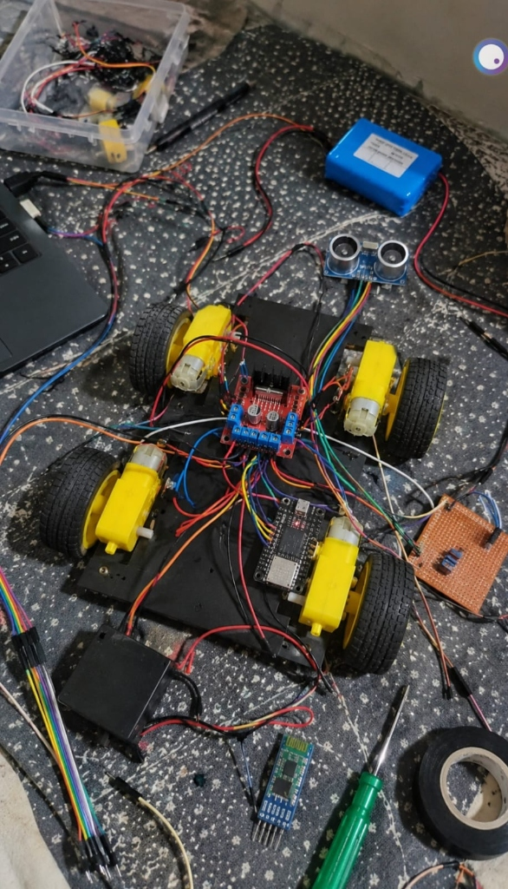

# ESP32 Gesture-Controlled Car

This is my ESP32 based gesture controlled car project made using two ESP32 microcontrollers, an MPU-9250 IMU sensor, an L298N motor driver, four BO geared DC motors and an HC-SR04 ultrasonic distance sensor.

The car uses a 4-wheel drive system with skid steering. One ESP32 is worn on the hand and reads the tilt angles using the MPU-9250 sensor, and sends the movement commands wirelessly over ESP-NOW. The receiving ESP32 on the car receives the commands and controls the left and right motors independently through the L298N driver.

This allows the car to move forward, turn left and right, stop, toggle reverse drive, and also stop automatically when something comes too close in front of it.

The project includes the CAD model, circuit connections, ESP32 code and the required setup to build and control the car.


## features

- ESP32 as main controller and receiver
- MPU-9250 IMU for hand gesture detection
- Direct wireless communication using ESP-NOW (no wifi router needed)
- L298N dual H-bridge motor driver
- 4 BO geared motors with rubber wheels
- Skid / differential steering
- Forward, backward toggle, left and right movement
- HC-SR04 ultrasonic sensor for obstacle avoidance
- PWM based motor speed control
- Custom 3D CAD chassis designed in Fusion 360
- Battery powered with 7.4V Li-ion battery

## BOM – bill of materials

| component | quantity | price (USD) | total (USD) | purpose |
|---|:---:|---:|---:|---|
| [ESP32 development board](https://robu.in/product/esp-wroom-32-wifi-bluetooth-networking-smart-component-development-board/) | 2 | $4.49 | $8.98 | controller and receiver |
| [MPU-9250 IMU sensor](https://robu.in/product/mpu-9250-9-axis-attitude-gyro-accelerometer-magnetometer-sensor-module/) | 1 | $4.20 | $4.20 | reads hand tilt |
| [L298N motor driver](https://robu.in/product/l298n-2a-based-motor-driver-module/) | 1 | $2.50 | $2.50 | drives the motors |
| [BO geared DC motors (6V)](https://robu.in/product/dual-shaft-bo-motor-straight/) | 4 | $1.10 | $4.40 | drives the wheels |
| [65mm robot wheels](https://robu.in/product/smart-car-robot-plastic-tire-wheel/) | 4 | $0.80 | $3.20 | car wheels |
| [HC-SR04 ultrasonic sensor](https://robu.in/product/ultrasonic-transceiver-module-hc-sr04/) | 1 | $1.20 | $1.20 | detects obstacles |
| [7.4V 2S Li-ion battery](https://robu.in/product/orange-2s-7-4v-2200mah-25c-lithium-polymer-battery-pack-lipo/) | 1 | $9.50 | $9.50 | powers the car |
| Jumper wires | as required | — | — | circuit wiring |
| Power switch | 1 | $0.40 | $0.40 | on/off switch |
| 3D printed parts | as required | — | — | chassis and mounts |

## circuit connections


The controller ESP32 reads pitch and roll values from the MPU-9250 sensor and sends small command packets over ESP-NOW.

The car ESP32 receives the packet and drives the motors through the L298N driver using direction pins and PWM.

### Hand controller: MPU-9250 to ESP32

| MPU-9250 | ESP32 |
|---|---|
| VCC | 3V3 |
| GND | GND |
| SDA | GPIO 15 |
| SCL | GPIO 14 |

### Car receiver: L298N to ESP32

| L298N | ESP32 |
|---|---|
| IN1 | GPIO 26 |
| IN2 | GPIO 25 |
| IN3 | GPIO 17 |
| IN4 | GPIO 16 |
| ENA | GPIO 32 |
| ENB | GPIO 33 |

ENA and ENB controls the speed of left and right motors using PWM.

### HC-SR04 ultrasonic sensor to ESP32

| HC-SR04 | ESP32 |
|---|---|
| VCC | 5V |
| GND | GND |
| TRIG | GPIO 18 |
| ECHO | GPIO 19 |

Note: Echo pin gives 5V output so use a simple resistor divider before connecting to ESP32 pin 19 so it don't damage the pin.

### motors

| L298N | motors |
|---|---|
| OUT1 / OUT2 | left side motors |
| OUT3 / OUT4 | right side motors |

Both left motors are wired together in parallel, and both right motors are wired together in parallel.

If any motor rotates backward, just swap the two wires on the L298N screw terminal.

## power connections

The motors get power directly from the 7.4V battery connected to the L298N power terminals.

The ESP32 is powered using 5V supply through the VIN pin.

```text
7.4V Battery (+)
       |
       ├── Switch ──► L298N 12V terminal
       |
       └── 5V regulator / buck ──► ESP32 VIN & Sensor VCC

7.4V Battery (-)
       |
       ├── L298N GND
       └── ESP32 GND
```

All grounds must be connected together.

```text
Battery (-)
   |
   ├── L298N GND
   ├── ESP32 GND
   └── HC-SR04 GND
```

Do not try to power the DC motors from the ESP32 pins directly.

## how to build this

**step 1:** Collect all the parts mentioned in the BOM table.

**step 2:** Print the chassis parts using the CAD files from the `3D Cad/` folder.

**step 3:** Mount the four BO motors on the chassis and fit the 65mm wheels.

**step 4:** Fix the L298N motor driver and the receiver ESP32 inside the chassis.

**step 5:** Wire the two left motors to OUT1 and OUT2, and the two right motors to OUT3 and OUT4.

**step 6:** Connect IN1, IN2, IN3, IN4, ENA, and ENB from L298N to the ESP32.

**step 7:** Mount the ultrasonic sensor at the front bumper and connect Trig and Echo pins.

**step 8:** For the hand controller, wire the MPU-9250 sensor with the second ESP32.

**step 9:** Flash a MAC address reading sketch on the car ESP32 and copy its MAC address from serial monitor.

**step 10:** Put that MAC address in `GestureController.ino` sketch.

**step 11:** Upload `GestureController.ino` to the hand controller and `GestureCarReceiver.ino` to the car.

**step 12:** Keep the car lifted up in air and test all hand movements.

**step 13:** Put the car on floor and enjoy driving it around.

## How the car works????

The working of the car is simple:

```text
Hand tilt
    ↓
MPU-9250 sensor
    ↓
Transmitter ESP32
    ↓
Calculate pitch and roll
    ↓
Send command over ESP-NOW
    ↓
Receiver ESP32
    ↓
Obstacle check (distance < 20cm?)
 ├── Yes ──► Stop + turn right
 └── No  ──► Run motor command
                 ↓
           L298N driver
           ┌───────────┐
           ↓           ↓
      Left motors  Right motors
           ↓           ↓
      Left wheels  Right wheels
```

The transmitter reads the accelerometer values ax, ay, az and calculates tilt angle:

```text
pitch = atan2(ax, sqrt(ay * ay + az * az)) * 180 / 3.14
roll  = atan2(ay, sqrt(ax * ax + az * az)) * 180 / 3.14
```

If the tilt is more than 15 degree, it triggers the command:
- Pitch forward (> 15°) -> Car goes forward
- Pitch backward (< -15°) -> Toggles reverse mode
- Roll right (> 15°) -> Turns right
- Roll left (< -15°) -> Turns left
- Hand flat -> Car stops

The packet is sent every 100ms so there is almost no delay.

## gesture controls

The car uses skid steering to turn:

```text
Tilt Forward

Left wheels   →→→
Right wheels  →→→
(moves forward)
```

```text
Tilt Left

Left wheels   ■■■ (stop)
Right wheels  →→→ (forward)
(turns left)
```

```text
Tilt Right

Left wheels   →→→ (forward)
Right wheels  ■■■ (stop)
(turns right)
```

```text
Hand Flat

Left wheels   ■■■ (brake)
Right wheels  ■■■ (brake)
(car stops)
```

```text
Tilt Backward

Toggles between forward and backward direction.
```

## obstacle avoidance

The ultrasonic sensor keeps checking if anything is in front:

```text
HC-SR04 sensor
      ↓
Measures front distance
      ↓
Distance <= 20 cm?
 ├── Yes:
 │     1. Stop motors
 │     2. Wait 200 ms
 │     3. Turn right for 350 ms
 │     4. Stop again
 └── No:
       Continue normal driving
```

This stops the car from hitting walls accidentally.

## speed control

The ESP32 uses PWM channels on GPIO 32 and 33 to control motor speed.

In the code, the speed is set around `180` (out of 255). You can change this number in the receiver sketch if you want the car faster or slower.

## Testing

Test everything step by step before running on floor:

### 1. Controller test
Open serial monitor at 115200 baud for the controller. Tilt your hand and check if the commands print properly.

### 2. Wireless test
Check if the car ESP32 receives the packets when you move the controller.

### 3. Motor direction test
Hold the car in your hand and check if the wheels spin the right way when you tilt forward, left and right.

### 4. Obstacle sensor test
Put your hand in front of the sensor within 20cm while wheels are spinning and see if it stops and turns.

### 5. Floor test
Put it on a clear floor and test driving it with hand gestures.

## CAD model





The CAD model has the chassis body, motor mount holes and space for the battery and electronics.

All the files are in `3D Cad/` folder:
- `The Nonchalant (1).f3d`: editable Fusion 360 file
- `The Nonchalant.step`: full assembly step file
- other `.step` files for each printed body parts

## Things to keep in mind

1. Make sure all GND pins are connected together or the signals will glitch.
2. Never connect the DC motors directly to ESP32 pins.
3. The HC-SR04 echo pin is 5V, ESP32 pins are 3.3V, so use two resistors as a voltage divider.
4. Keep the wheels elevated off the ground during first test so the car doesn't run away.
5. Remember to change the MAC address in the transmitter code to match your receiver ESP32.
6. Mount the MPU-9250 flat on your hand or glove so the tilt directions match properly.
7. Use good quality wires for motor power so there is no voltage drop.
8. If a motor turns in wrong direction, just invert the wires on L298N terminal.
9. Secure the battery tightly with tape or zip tie so it don't fall out while driving.
10. The backward gesture toggles reverse mode, so bring hand flat again after tilting back.

## Final result

I built this project to make a simple wireless gesture controlled robot car using ESP32.

The hand tilt controls the car directly over ESP-NOW without needing any phone app or wifi router, and the ultrasonic sensor helps prevent crashes.

```text
Hand Gesture
     ↓
  MPU-9250
     ↓
Transmitter ESP32
     ↓
  ESP-NOW
     ↓
 Receiver ESP32
     ↓
L298N + Motors
     ↓
   Car moves!
```

## Demo

- Video demo: [Watch driving demo](assets/VIDEO-2026-10-23-02-05-10.mp4)
- Full build notes and photos in [JOURNAL.md](JOURNAL.md)
